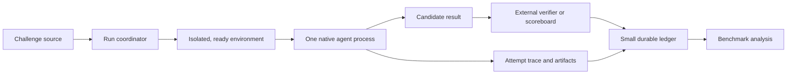

# Architecture review

**Recommendation: revise before implementation.** The draft makes a real agent run a v1 feature while v0 builds a coordinator, journal, leases, plugin registry, and fake adapter. That order cannot show whether the harness improves solve rate or wall-clock performance. The first measured artifact should be a native agent solving challenges in a prepared environment.

The evidence supports that priority, with limits. In a 200-challenge NYU CTF Bench study, the same Gemini 3 Pro setup solved **104/200 on Kali versus 85/200 on Ubuntu**. In that study’s planner/executor test, Pro/Pro solved 52%, Pro/Flash 28.5%, and Flash/Flash 27%. Those are single-trial results within D-CIPHER, using two Gemini models; they justify testing the deployed environment and defaulting away from mixed roles, not a universal model-ranking rule. [Study and limitations](https://s3.amazonaws.com/edas.manuscripts/final/1571257845.pdf?title=PDF+file)

## KEEP

| Decision | Why it earns its place |
|---|---|
| Native agent as the execution unit | Codex and Claude Code have their own tool, context, and permission behavior. CAGE likewise runs installed agents rather than recreating their loops. [CAGE](https://github.com/AgentCyberRange/CAGE) |
| Environment as part of the measured configuration | Installed tools, readiness, PTY behavior, and target access can change outcomes materially. [Controlled study](https://s3.amazonaws.com/edas.manuscripts/final/1571257845.pdf?title=PDF+file) |
| External outcome verification | A worker’s “solved” message is evidence to inspect, not an authoritative result. |
| Single-host SQLite for small durable state | Appropriate for challenge and submission transitions if transactions never span external waits. |
| Independent attempts as an experiment | Pass@k may help, but only when its added solves justify elapsed time and scarce execution slots. |

## DELETE/DEFER

- **Delete the fake-only v0 success criterion** in [§21](/home/yc54616/workspace/ctfh-v2-review/ARCHITECTURE_DRAFT.md:504). Contract conformance without a real agent, target, and verifier proves little about the objective.
- **Defer** `PluginRegistry`, package entry points, a conformance suite for every hypothetical plugin, `BenchmarkRegistry`, and a generic `ModelBackend`. Configuration and one thin launch seam suffice.
- **Defer** the general `ResourceLeaseManager` and operation journal. Give each v0 attempt its own workspace and process tree. Add durable submission handling when live submission exists.
- **Defer** the strategy catalogue, learned scheduler, browser decision policy, Jev, skills framework, and context integrations. Each adds startup, context, or coordination cost before its marginal solve gain is known.
- **Delete the global GhostChrome-first policy** from the harness design in [§13](/home/yc54616/workspace/ctfh-v2-review/ARCHITECTURE_DRAFT.md:311). A browser is a task capability; direct HTTP or terminal work may be faster. Authenticated browser state cannot be assumed portable between drivers.
- **Delete “zero kernel changes when swapping any module” as a v0 goal.** A few explicit seams are cheaper than preserving interfaces whose real requirements have not been observed.

A 2026 competition report found its winning agent used a small, direct loop, while more elaborate submissions often did worse. It covered only 20 vulnerability tasks and confounded architecture with model choice, so it is a warning against spending v0 on architecture, not proof that simple agents always win. [AgentCTF report](https://ctf.secure-agent.com/agentctf_report_2026.pdf)

## CHANGE

1. **Replace revision-based result rejection with epoch-based effect control.** In [§7](/home/yc54616/workspace/ctfh-v2-review/ARCHITECTURE_DRAFT.md:155), an attempt’s `base_revision` conflates newly learned facts with a changed target. A concurrent attempt may discover a valid flag after another worker adds an observation. Store its evidence; reject *actions* tied to an obsolete target instance or resource generation.
2. **Treat fencing as enforceable only at an I/O boundary.** Incrementing a lease generation in SQLite cannot stop an old process that still holds a browser socket, PTY, or target credential. Route mutable actions through a broker that checks the token, or terminate and isolate the old process before transfer.
3. **Do not promise exactly-once external effects.** A local idempotency key in [§8](/home/yc54616/workspace/ctfh-v2-review/ARCHITECTURE_DRAFT.md:193) cannot establish whether a remote flag submission succeeded after a lost response. Record `UNKNOWN`, query an authoritative result where available, and never blindly resend.
4. **Make cancellation a bounded supervisor protocol.** A cancel request does not cancel an in-flight provider call or remote action. Stop new local actions, allow a short grace period, terminate the process group, reap children, quarantine uncertain resources, and reconcile external effects separately. Do not let an indefinitely `UNKNOWN` attempt block unrelated challenges.
5. **Replace “expected score / wall-clock time” with a deadline objective.** The ratio in [§12](/home/yc54616/workspace/ctfh-v2-review/ARCHITECTURE_DRAFT.md:282) can favor quick low-value solves while missing high-value points before event close. Allocate scarce slots by estimated *marginal points by the deadline*, including queue, setup, rate limits, and the opportunity cost of parallel attempts.
6. **Make native-agent capability failures explicit.** A CLI may ignore a requested model, change its approval mode, compact context, hide tool output, or leave child processes running. Pin binary and configuration versions; record effective model and permissions; fail a run when required capabilities are unavailable. Do not claim complete raw-tool provenance when the native harness cannot expose it.
7. **Treat browser “page revision” as an observation token.** It does not fence server-side changes. Revalidate a target immediately before a consequential click or submission; bind browser sessions to an attempt and target epoch.
8. **Scope context stores per trial.** The “capture raw, then transform” pipeline in [§15](/home/yc54616/workspace/ctfh-v2-review/ARCHITECTURE_DRAFT.md:370) must account for native tools whose raw output is inaccessible. Record trace coverage. Never let prior runs’ flags, writeups, or indexed artifacts enter a later benchmark attempt.

## Corrected architecture

The coordinator owns run identity, deadlines, process supervision, and the small number of durable transitions. The agent owns its reasoning and ordinary tool loop. The environment supplies a verified image, target instance, workspace, network scope, and optional PTY or browser. Benchmark analysis stays outside the live execution path. EnIGMA’s evaluation supports prioritizing usable interactive debugger and connection tools; it does not require a general tool-plugin layer. [EnIGMA](https://arxiv.org/abs/2409.16165)

## Corrected contracts

| Boundary | Required contract |
|---|---|
| **RunSpec** | Immutable `challenge_id`, `attempt_id`, `target_instance_id`, `target_epoch`, deadline, profile fingerprint, workspace, allowed capabilities, and verifier identity. |
| **Environment** | `prepare → health_check → fingerprint → destroy`. Preparation returns a ready target and isolated attacker workspace. Reset creates a new `target_epoch`. No mutable workspace or browser profile is shared between attempts. |
| **Agent runner** | `start(RunSpec) → process handle`; stream timestamped events when available; `request_stop`, `terminate`, `reap`. Declare whether tool calls and raw outputs are observable. Unsupported model or permission settings are errors. |
| **Attempt result** | Append-only observations and artifact references with attempt-local sequence numbers. Preserve late evidence for analysis; it grants no right to act on a reset target. |
| **Verifier** | Returns an authoritative verdict and its source. In an offline benchmark, use the isolated oracle. In a live competition, local flag-shape checks are provisional; scoreboard acceptance is authoritative. |
| **Submitter, when added** | One serialized submission path per challenge and candidate hash. Persist intent before send; distinguish accepted, rejected, and unknown delivery. A retry requires remote confirmation or a remote idempotency guarantee. |

## Concurrency model

Start with **one attempt per challenge and one isolated target instance per attempt**. Run different challenges concurrently up to measured provider, CPU, memory, and target limits. Serialize only short ledger transitions and live submissions; never hold a database transaction while waiting on a model, process, browser, or network call.

When parallel attempts later demonstrate a gain, give each an independent workspace, process tree, browser context, and preferably target instance. A target reset invalidates actions from the previous epoch. An accepted candidate wins a compare-and-set lifecycle transition; late candidates remain trace data. If a mutable external resource cannot be isolated or fenced at the I/O boundary, serialize its use. SQLite WAL is adequate here, but its single writer and unique constraints do not themselves solve stale external actions.

## Benchmark unit

A `HarnessProfile` is a useful **configuration label**, not the complete experimental unit proposed in [§6](/home/yc54616/workspace/ctfh-v2-review/ARCHITECTURE_DRAFT.md:124). Record each trial as:

`challenge version × target instance × agent binary/config × effective model × environment image/tool versions × prompt/context/skills × deadline × parallelism × run seed/order`.

Compare profiles on paired challenge sets under the same wall-clock and resource limits. Report points accepted by the deadline, time to first accepted result, solve probability over time, queue/setup/agent/tool/verification/cleanup time, and infrastructure failures. Evaluate a routing policy at **event level**, where attempts compete for the same slots and provider quotas; pass@k under unconstrained extra compute is not a fair scheduler comparison.

Public historical CTF scores need a separate label from fresh holdout results. CTFusion demonstrated search-time solution leakage, and NIST documented agents finding CyBench flags in public writeups and benchmark-accessible configuration. Isolate grader files, prior traces, browser state, and persistent context indexes from workers; audit successful traces for solution retrieval. [CTFusion](https://arxiv.org/abs/2605.11504), [NIST](https://www.nist.gov/caissi/2-examples-cheating-caisis-agent-evaluations)

## v0 scope

Build one real, pinned native-agent adapter; one ready security-tool image with shell and PTY; isolated local challenge instances; an external verifier; a process supervisor with deadlines and child cleanup; a small SQLite run ledger; and timing plus outcome traces. Use fixed, explicit configuration. Include representative tasks that exercise interactive tooling, then run a paired comparison against a leaner environment. Keep the strongest single-agent direct run as the routing baseline.

V0 passes when it can **repeatedly run and measure real solves**, recover from a crashed or cancelled process without contaminating the next trial, and distinguish a valid result from worker self-report. Adapter-swapping tests with a fake worker remain useful unit tests, but cannot be its completion gate.

## Top 10 risks

1. **Fake-only v0** delays the first evidence about solve rate.
2. **Native-agent configuration drift** changes the effective model, permissions, tools, or context behavior without changing the profile label.
3. **Poor environment readiness** wastes the most valuable early minutes on installs, startup, and tool discovery.
4. **Unfenced old processes** act after a lease transfer or target reset.
5. **Revision-based stale rejection** discards valid findings from concurrent workers.
6. **Unknown live submission outcomes** cause duplicate submissions or false solved states.
7. **Cancellation leaks** leave PTYs, children, browser sessions, or provider work consuming slots.
8. **Shared browser or context state** contaminates attempts and benchmarks.
9. **Public benchmark leakage** rewards retrieved flags instead of solving ability.
10. **Premature routing and parallelism** consume scarce time and quotas without incremental accepted points.

**Single biggest performance simplification:** move a **single strong native agent in a ready, isolated, well-tooled environment** to v0, with an external verifier and measured deadline. Build concurrency, journals, plugins, and learned routing only against the wall-clock and solve-rate gains that baseline reveals.